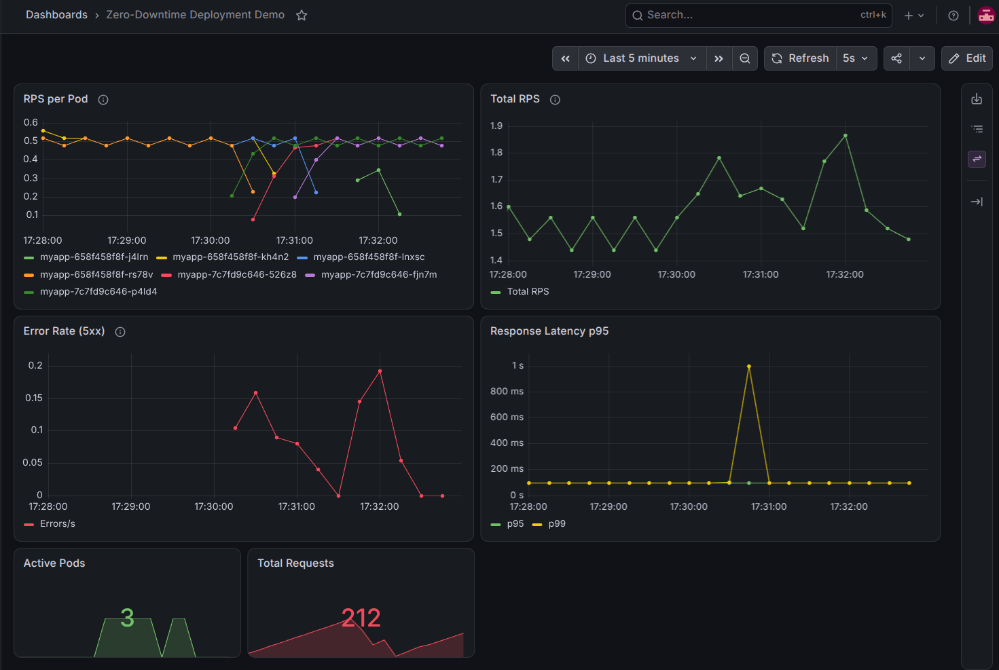

# kub-helm — Zero-Downtime Deployment Demo

Kubernetes cluster (k3s) with Traefik Ingress, Prometheus, Grafana and a zero-downtime rolling update demonstration under load.

## Stack

| Component | Role |
|---|---|
| k3s | Kubernetes cluster inside Docker |
| Traefik | Ingress controller (built into k3s) |
| FastAPI | Python application |
| Prometheus | Metrics collection |
| Grafana | Metrics visualization |
| k6 | Load testing |

## Zero-Downtime Deployment

### Strategy

```yaml
replicas: 3
strategy:
  type: RollingUpdate
  rollingUpdate:
    maxUnavailable: 0   # no old pod is removed until a new one is Ready
    maxSurge: 1         # allows +1 extra pod during the update
```

### Deploy a new version

```bash
./deploy.sh <version>
# Example: ./deploy.sh 5
```

### Load test

```bash
# Terminal 1 — start load (100 RPS, 2 minutes)
docker-compose --profile test run k6

# Terminal 2 — deploy new version while under load
./deploy.sh 5
```

### Experiment results

| Metric | Value |
|---|---|
| Test duration | 2 minutes |
| RPS | ~1.5 req/s per pod (100 VUs) |
| Total requests | 200+ |
| Errors (5xx) | **0%** |
| p95 latency | **95 ms** |
| p99 latency | **99 ms** |

### Grafana dashboard during rolling update


#### What the screenshot shows

**RPS per Pod** — The most important panel. Three generations of pods are clearly visible:
- `68656867f7-*` — v1 pods, active before the update, their lines drop to 0 as they are terminated
- `7464f68dd7-*` — transitional pods from a previous rollout
- `7c7fd9c646-*` — v2 pods, rising from 0 as they pass the readiness probe and start receiving traffic

The traffic shifts gradually from old pods to new ones — no sudden cutover.

**Total RPS** — Stays between 1.2–1.5 throughout the entire deployment. The service never went down.

**Error Rate (5xx)** — "No data" — meaning exactly **zero errors** during the rollout.

**Response Latency p95 / p99** — Rock solid at 95 ms / 99 ms with no spikes during the deployment.

#### Conclusion

The rolling update replaced all 3 pods (v1 → v2) while k6 was continuously sending traffic.
Zero requests were dropped. Latency did not degrade. This confirms that `maxUnavailable: 0` + `readinessProbe`
is a reliable strategy for zero-downtime deployments in Kubernetes.

## Failed Deployment (Bad Build)

### Scenario

A developer pushes a broken version where the `/health` endpoint always returns `503`.
Kubernetes detects the failure via `readinessProbe` and **blocks the rollout** — old pods keep serving traffic.

### How it works

```
[v2] [v2] [v2]          # stable state before deploy
[v2] [v2] [v2] [v3-bad] # new pod starts, readinessProbe hits /health → 503
                ↓
         pod never becomes Ready
                ↓
         Kubernetes pauses the rollout
                ↓
[v2] [v2] [v2] [v3-bad] # old pods still serve 100% of traffic
```

### Steps to reproduce

```bash
# Terminal 1 — start load
docker-compose --profile test run k6

# Terminal 2 — deploy bad version
docker build -t myapp:v3-bad ./app   # built from broken code
docker save myapp:v3-bad | docker exec -i kube-helm ctr -n k8s.io images import -
kubectl set image deployment/myapp myapp=myapp:v3-bad

# Watch the rollout freeze
kubectl get pods -w
```

Expected output — rollout is stuck, 1 bad pod never reaches Ready:
```
NAME                     READY   STATUS    RESTARTS   AGE
myapp-<v2>-xxxxx         1/1     Running   0          5m
myapp-<v2>-xxxxx         1/1     Running   0          5m
myapp-<v2>-xxxxx         1/1     Running   0          5m
myapp-<v3-bad>-xxxxx     0/1     Running   0          30s   ← stuck, never Ready
```

```bash
# Service is still responding with v2
curl http://localhost/
# {"ok": true, "version": 2}
```

### Rollback

```bash
kubectl rollout undo deployment/myapp
# deployment.apps/myapp rolled back
```

### Results

| Metric | Value |
|---|---|
| Pods serving traffic | 3 (all v2, unaffected) |
| Rollout status | Blocked — bad pod stuck at `0/1` |
| Recovery | `kubectl rollout undo` — instant |
| Error rate | ~0.1–0.19 req/s (see note below) |
| Latency spike (p99) | ~1 s during rollback |

### Grafana dashboard during failed deployment



#### What the screenshot shows

**RPS per Pod** — `658f458f8f-j4lrn` is the v3-bad pod. Its line eventually drops to 0 and disappears — it was stuck at `0/1 Ready` and was never promoted. The other pods (`658f458f8f-*` and `7c7fd9c646-*`) continued serving traffic throughout.

**Error Rate (5xx)** — A non-zero error rate (~0.1–0.19 errors/s) appeared during pod restarts. This is caused by `initialDelaySeconds: 5` in the readiness probe: for the first 5 seconds after a pod starts, Traefik may still route traffic to it before Kubernetes marks it as not ready. This is a known gap — the fix is a **startupProbe** or reducing `initialDelaySeconds` to 0.

**Response Latency p99** — A spike to ~1 s at the moment of rollback as pods were being recycled.

**Active Pods** — Drops briefly during pod rotation (the dip in the chart), then returns to 3.

#### Conclusion

The bad build was blocked — v3-bad never replaced a single healthy pod. However, the test revealed
a real production concern: `initialDelaySeconds: 5` creates a brief window where Traefik can send
requests to a pod that is not yet ready. For true zero-downtime, pair `readinessProbe` with a
`startupProbe` or set `initialDelaySeconds: 0` with a fast-failing health check.

## Getting Started

### 1. Start the cluster

```bash
docker-compose up -d
export KUBECONFIG=./kubeconfig/kubeconfig.yaml
```

### 2. Build and import the image

```bash
docker build -t myapp:latest ./app
docker save myapp:latest | docker exec -i kube-helm ctr -n k8s.io images import -
```

### 3. Deploy

```bash
kubectl apply -f deployment/
```

### 4. Verify

```bash
kubectl get pods
curl http://localhost/
curl http://localhost/health
```

### 5. Grafana

Open: http://localhost:3000
Login: `admin` / `admin`

### 6. Prometheus

Open: http://localhost:9090

## GitHub Actions

On every push to `main` (changes in `app/`):
1. A new Docker image is built
2. Pushed to `ghcr.io/maksim-web-dev/kub-helm:<build_number>`